# motor_sim

A ROS 2 (Humble) Python package that demonstrates a simplified two-motor control
and telemetry simulation, inspired by underwater robotics.

In simple words: you tell the robot how fast to move and turn, and the node works
out how fast the left and right motors should spin. Like real motors, they speed
up and slow down gradually instead of jumping, and their RPM is reported back as
telemetry.

The node subscribes to velocity commands (`/cmd_vel`), converts them into left
and right motor RPM using differential-drive kinematics, simulates gradual motor
acceleration and deceleration, and publishes the RPM telemetry to ROS 2.

---

## Table of contents

1. [Features](#features)
2. [System architecture](#system-architecture)
3. [ROS 2 interface](#ros-2-interface)
4. [How it works (maths)](#how-it-works-maths)
5. [Project structure](#project-structure)
6. [Quick start (clone and run)](#quick-start-clone-and-run)
7. [Step-by-step setup](#step-by-step-setup)
8. [Run](#run)
9. [Testing and results](#testing-and-results)
10. [Design decisions](#design-decisions)
11. [Limitations and future work](#limitations-and-future-work)
12. [License and author](#license-and-author)

---

## Features

- Subscribes to `geometry_msgs/msg/Twist` on `/cmd_vel` (uses `linear.x` and `angular.z`)
- Two-motor differential-drive model (left and right thrusters)
- Converts velocity to target RPM and clamps it to a configurable maximum
- First-order lag model, so RPM ramps up and down smoothly instead of jumping
- Publishes telemetry on `/motor/rpm` at a configurable rate (default 50 Hz)
- All physical constants are ROS parameters with defaults, and can be changed at
  start-up without editing code

---

## System architecture

```
┌─────────────────────────────────────────────────────────┐
│                 Velocity command source                 │
│      (joystick, navigation node, or ros2 topic pub)     │
│                                                         │
│  Publishes:  /cmd_vel  (geometry_msgs/Twist)            │
└────────────────────────────┬────────────────────────────┘
                             │
                             ▼
┌─────────────────────────────────────────────────────────┐
│                motor_node  (this package)               │
├─────────────────────────────────────────────────────────┤
│  Subscribes:  /cmd_vel                                  │
│                                                         │
│  1. Differential drive    -> target RPM (L, R)          │
│  2. First-order motor lag -> current RPM                │
│                                                         │
│  Publishes:   /motor/rpm                                │
└────────────────────────────┬────────────────────────────┘
                             │
                             ▼
┌─────────────────────────────────────────────────────────┐
│                     Telemetry viewer                    │
│         (logger, dashboard, or ros2 topic echo)         │
│                                                         │
│  Subscribes:  /motor/rpm  (std_msgs/Float32MultiArray)  │
│               data = [left_rpm, right_rpm]              │
└─────────────────────────────────────────────────────────┘
```

In the tests below, the three parts of this chain run in three terminals:

| Terminal | Program                               | Role                                                       |
|----------|---------------------------------------|------------------------------------------------------------|
| 3        | `ros2 topic pub`                      | **Publisher** of `/cmd_vel` (sends the velocity command)   |
| 1        | `motor_node` (this package)           | **Subscriber** of `/cmd_vel` and **publisher** of `/motor/rpm` |
| 2        | `ros2 topic echo`                     | **Subscriber** of `/motor/rpm` (prints the telemetry)      |

Terminals 2 and 3 are only test tools. On a real robot, a joystick or navigation
node would send `/cmd_vel`, and a logger or dashboard would read `/motor/rpm`.

---

## ROS 2 interface

| Direction  | Topic        | Type                             | Description                                |
|------------|--------------|----------------------------------|--------------------------------------------|
| Subscribes | `/cmd_vel`   | `geometry_msgs/msg/Twist`        | Velocity command (`linear.x`, `angular.z`) |
| Publishes  | `/motor/rpm` | `std_msgs/msg/Float32MultiArray` | `data = [left_rpm, right_rpm]`             |

### Parameters

| Parameter          | Default | Unit | Meaning                                            |
|--------------------|---------|------|----------------------------------------------------|
| `wheel_radius`     | 0.05    | m    | Effective radius used to convert speed to RPM      |
| `wheel_separation` | 0.4     | m    | Distance between the left and right thrusters      |
| `max_rpm`          | 3000.0  | RPM  | Saturation limit (output is clamped to +/- this)   |
| `time_constant`    | 0.5     | s    | Motor lag time constant (larger = slower response) |
| `publish_rate`     | 50.0    | Hz   | Rate of the simulation update and telemetry        |

The defaults are declared in [`motor_sim/motor_node.py`](motor_sim/motor_node.py).
Any of them can be overridden when starting the node, for example:

```bash
ros2 run motor_sim motor_node --ros-args -p wheel_radius:=0.1
```

---

## How it works (maths)

**1. Wheel speeds (differential drive)**

```
half    = angular.z * wheel_separation / 2
v_left  = linear.x - half
v_right = linear.x + half
```

**2. Speed to RPM**

```
rpm = v * 60 / (2 * pi * wheel_radius)
```

The result is clamped to the range `[-max_rpm, +max_rpm]`.

**3. Motor response (first-order lag)**

Every `dt = 1 / publish_rate` seconds:

```
alpha       = 1 - exp(-dt / time_constant)
current_rpm = current_rpm + (target_rpm - current_rpm) * alpha
```

This is the exact discrete form of a first-order system, so the response is
independent of the publish rate. After one time constant (0.5 s) the motor
reaches about 63% of the way to the target.

**Worked example** (defaults, `linear.x = 0.5`, `angular.z = 0.0`):

```
rpm = 0.5 * 60 / (2 * pi * 0.05) = 95.5 RPM  (both motors)
```

---

## Project structure

The project has two parts: the **ROS 2 workspace** `motor_ws` on the machine, and
the **package** `motor_sim` inside it. Only the `motor_sim` package folder is the
Git repository and is uploaded to GitHub. The workspace itself and the
`build/`, `install/` and `log/` folders that `colcon` generates are not in Git.

```
~/motor_ws/                         <- ROS 2 workspace (NOT in Git)
├── build/                          <- generated by colcon (NOT in Git)
├── install/                        <- generated by colcon (NOT in Git)
├── log/                            <- generated by colcon (NOT in Git)
└── src/
    └── motor_sim/                  <- the package = the Git repository (on GitHub)
        ├── config/
        │   └── motor_params.yaml   <- default parameters
        ├── launch/
        │   └── motor_sim.launch.py <- starts the node with the YAML config
        ├── motor_sim/
        │   ├── __init__.py
        │   └── motor_node.py       <- the node (conversion, lag model, telemetry)
        ├── resource/
        │   └── motor_sim
        ├── test/                   <- default ament lint tests
        ├── LICENSE
        ├── README.md
        ├── package.xml
        ├── setup.cfg
        └── setup.py
```

`colcon build` is always run from `~/motor_ws`.

### Source files

| File | Purpose |
|------|---------|
| [`motor_sim/motor_node.py`](motor_sim/motor_node.py) | The node: subscriber, RPM conversion, motor lag, telemetry |
| [`setup.py`](setup.py) | Package metadata and the `motor_node` entry point |
| [`package.xml`](package.xml) | Package metadata and dependencies |

---

## Quick start (clone and run)

For anyone who only wants to run the project, without repeating the setup steps
below. Requires Ubuntu 22.04 with ROS 2 Humble installed.

```bash
source /opt/ros/humble/setup.bash
mkdir -p ~/motor_ws/src
cd ~/motor_ws/src
git clone https://github.com/<your-github-username>/motor_sim.git
cd ~/motor_ws
colcon build --symlink-install
source install/setup.bash
```

Then continue with [Run](#run).

---

## Step-by-step setup

This records exactly how the project was set up, so it can be reproduced from
scratch.

**Tested on:** Ubuntu 22.04.5 LTS (VirtualBox VM), ROS 2 Humble, Python 3.10.12, Git 2.34.1.

### 1. Check the operating system, Python and Git

**Why this step:** ROS 2 Humble officially supports Ubuntu 22.04 and uses
Python 3.10. Git is needed for version control.

```bash
lsb_release -a
python3 --version
git --version
```

> **Screenshot:** the output of all three commands in one picture.
>
> 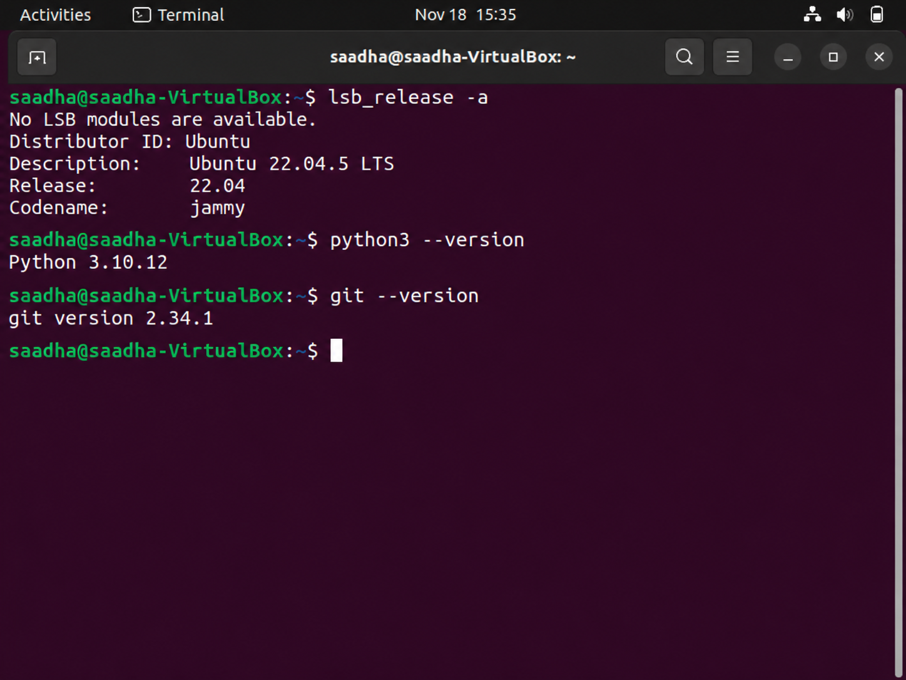

### 2. Set up your Git identity

**Why this step:** Git labels every commit with this name and email, and `main`
is the default branch name.

```bash
git config --global user.name "Nafeesath Saadha"
git config --global user.email "<your-email>"
git config --global init.defaultBranch main
git config --list
```

### 3. Check ROS 2 and the build tool

**Why this step:** confirms Humble is installed, the environment loads, and
`colcon` (the build tool) exists.

```bash
ls /opt/ros
source /opt/ros/humble/setup.bash
echo $ROS_DISTRO
which colcon
```

Expected: `humble`, `humble`, and `/usr/bin/colcon`.

> **Screenshot:** the output of these commands.
>
> 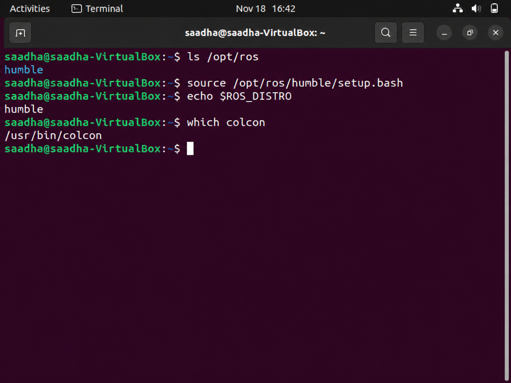

### 4. Create the workspace and the package

**Why this step:** a separate workspace keeps this project apart from other ROS 2
work, and `ros2 pkg create` generates the package skeleton.

```bash
mkdir -p ~/motor_ws/src
cd ~/motor_ws/src
ros2 pkg create --build-type ament_python motor_sim \
  --dependencies rclpy geometry_msgs std_msgs
```

- `rclpy`: the Python ROS 2 client library
- `geometry_msgs`: provides `Twist`
- `std_msgs`: provides `Float32MultiArray`

### 5. Put the package under version control

**Why this step:** Git tracks the history, and `.gitignore` keeps generated
build output out of the repository.

```bash
cd ~/motor_ws/src/motor_sim
git init
printf "build/\ninstall/\nlog/\n__pycache__/\n*.pyc\n" > .gitignore
git add .
git commit -m "Create package skeleton"
```

### 6. Fill in the package metadata and add the license

**Why this step:** `ros2 pkg create` leaves `TODO` placeholders and warns that
the license is unknown. The metadata describes the package, and the license tells
others what they may do with the code.

**6a. `package.xml`:** edit it with the `nano` text editor:

```bash
nano ~/motor_ws/src/motor_sim/package.xml
```

Change these two lines (keep the tags, change only the text between them):

```xml
<description>Motor firmware simulator and ROS 2 bridge for underwater robotics</description>
<license>MIT</license>
```

Save with `Ctrl+O`, then `Enter`. Exit with `Ctrl+X`. Check it:

```bash
grep -E "description|license" ~/motor_ws/src/motor_sim/package.xml
```

**6b. `setup.py`:** the same two values need to match:

```bash
nano ~/motor_ws/src/motor_sim/setup.py
```

```python
    description='Motor firmware simulator and ROS 2 bridge for underwater robotics',
    license='MIT',
```

Save and exit the same way, then check it:

```bash
grep -E "description|license" ~/motor_ws/src/motor_sim/setup.py
```

Expected: the two lines above, with no `TODO` left in them.

**6c. `LICENSE` file:** `package.xml` and `setup.py` only name the license
(MIT). The repository should also contain the actual license text, so that
anyone using the code knows the exact terms, and GitHub can show the license on
the repository page. Create the file and paste the standard MIT text into it
(see [`LICENSE`](LICENSE)):

```bash
nano ~/motor_ws/src/motor_sim/LICENSE
```

Commit these changes so they are included when you publish in the next step:

```bash
cd ~/motor_ws/src/motor_sim
git add .
git commit -m "Add package metadata and MIT license"
```

### 7. Publish to GitHub

**Why this step:** so the code can be shared and reviewed.

1. On github.com, create a new **empty** repository named `motor_sim`
   (do not add a README, .gitignore or license on GitHub).
2. Create a **Personal Access Token (classic)** with the `repo` scope:
   GitHub -> Settings -> Developer settings -> Personal access tokens.
   GitHub no longer accepts the account password for `git push`.
3. Connect and push:

```bash
git remote add origin https://github.com/<your-github-username>/motor_sim.git
git branch -M main
git push -u origin main
```

When prompted, enter your GitHub username, and paste the token as the password.

> **Never commit or share your token.** If it is exposed, delete it in GitHub
> settings and generate a new one.

### 8. Write the motor node

**Why this step:** `motor_node.py` is the core of the project. It subscribes to
`/cmd_vel`, converts the command to target RPM, simulates the motor lag with a
timer, and publishes telemetry on `/motor/rpm`.

The node file goes in the **inner** `motor_sim` folder, next to `__init__.py`:

```bash
nano ~/motor_ws/src/motor_sim/motor_sim/motor_node.py
```

See the full code in [`motor_sim/motor_node.py`](motor_sim/motor_node.py).

Then register it as a runnable program by adding one line to `entry_points` in
`setup.py`:

```bash
nano ~/motor_ws/src/motor_sim/setup.py
```

```python
'console_scripts': [
    'motor_node = motor_sim.motor_node:main',
],
```

This line is what lets `ros2 run motor_sim motor_node` find the code.

> The node was developed in stages: first a subscriber on `/cmd_vel`, then the
> RPM conversion, motor lag and telemetry. The Git history shows the stages as
> separate commits.

### 9. Add the parameter file

**Why this step:** so the physical constants can be changed without editing code.

```bash
mkdir -p ~/motor_ws/src/motor_sim/config
nano ~/motor_ws/src/motor_sim/config/motor_params.yaml
```

Contents (see [`config/motor_params.yaml`](config/motor_params.yaml)):

```yaml
motor_node:
  ros__parameters:
    wheel_radius: 0.05
    wheel_separation: 0.4
    max_rpm: 3000.0
    time_constant: 0.5
    publish_rate: 50.0
```

### 10. Add the launch file

**Why this step:** starts the node and loads the parameter file with one command.

```bash
mkdir -p ~/motor_ws/src/motor_sim/launch
nano ~/motor_ws/src/motor_sim/launch/motor_sim.launch.py
```

See the full code in [`launch/motor_sim.launch.py`](launch/motor_sim.launch.py).

### 11. Install the config and launch folders in `setup.py`

**Why this step:** without this, `colcon build` does not copy the `launch` and
`config` folders, and `ros2 launch` cannot find them.

```bash
nano ~/motor_ws/src/motor_sim/setup.py
```

Add two imports at the top of the file:

```python
import os
from glob import glob
```

Add two entries to `data_files`:

```python
data_files=[
    ('share/ament_index/resource_index/packages',
        ['resource/' + package_name]),
    ('share/' + package_name, ['package.xml']),
    (os.path.join('share', package_name, 'launch'), glob('launch/*.launch.py')),
    (os.path.join('share', package_name, 'config'), glob('config/*.yaml')),
],
```

See the final file: [`setup.py`](setup.py).

### 12. Build

**Why this step:** compiles and registers the package. `--symlink-install` lets
later edits to the Python file take effect without rebuilding.

```bash
cd ~/motor_ws
colcon build --symlink-install
source install/setup.bash
```

A successful build ends with `Summary: 1 package finished`. Check that ROS can
find the node:

```bash
ros2 pkg executables motor_sim
```

Expected: `motor_sim motor_node`.

> **Screenshot:** the build summary and the executable check.
>
> 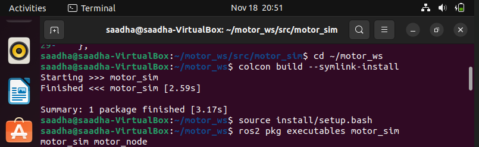

### 13. Commit and push

```bash
cd ~/motor_ws/src/motor_sim
git add .
git commit -m "Add motor node with RPM conversion, lag and telemetry"
git push
```

---

## Run

Run these two lines first in every new terminal:

```bash
source /opt/ros/humble/setup.bash
source ~/motor_ws/install/setup.bash
```

Start the terminals in this order: 1, then 2, then 3. Keep all three open.

### Terminal 1: start the node

```bash
ros2 run motor_sim motor_node
```

Expected: `Motor node started, waiting for /cmd_vel`.

> **Screenshot:** Terminal 1 after the node starts.
>
> 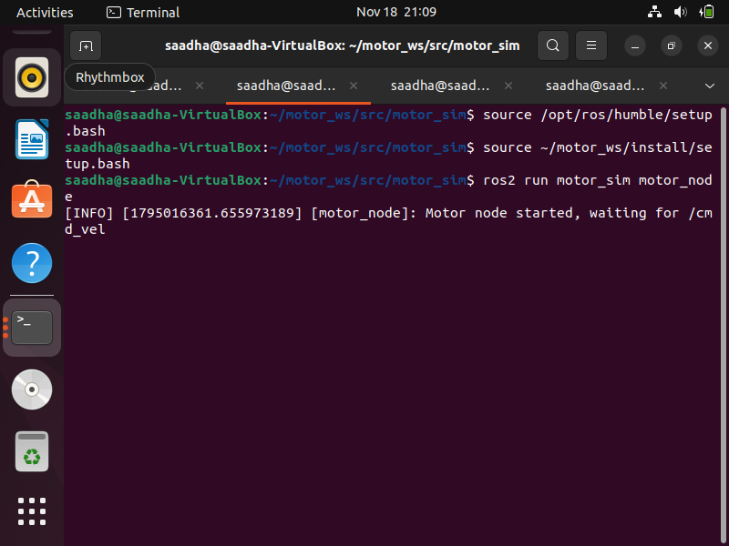

### Terminal 2: watch the telemetry

```bash
ros2 topic echo /motor/rpm
```

Expected: `data:` values of `0.0` while no command is being sent.

> **Screenshot:** Terminal 2 showing the telemetry.
>
> 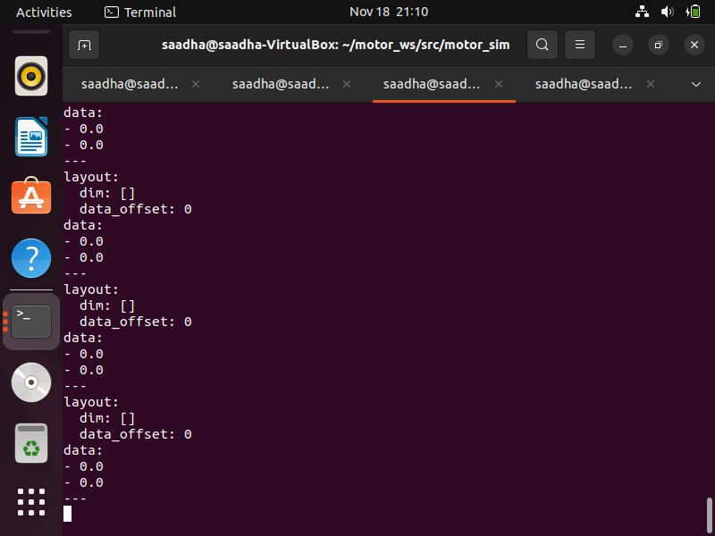

### Terminal 3: send a velocity command

```bash
ros2 topic pub --rate 2 /cmd_vel geometry_msgs/msg/Twist \
  "{linear: {x: 0.5}, angular: {z: 0.0}}"
```

Expected: `publishing #1`, `#2`, ... every half second. Terminal 1 then prints the
target RPM, and Terminal 2 shows the values climbing toward 95.5.

> **Screenshot:** Terminal 3 while publishing.
>
> 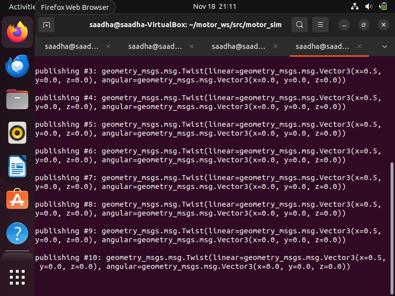

Stop any terminal with `Ctrl+C`. Only Terminal 1 is the project itself. Terminals
2 and 3 are test tools: a telemetry viewer and a command sender.

---

## Testing and results

Terminal roles are the same as in [Run](#run): Terminal 1 runs the node,
Terminal 2 watches `/motor/rpm`, Terminal 3 sends commands. Only one `motor_node`
may run at a time, and `Ctrl+C` must be pressed in the terminal that is running
the command you want to stop. A forgotten `ros2 topic pub` keeps the motors
running. Check with `ros2 topic info /cmd_vel` (Publisher count should be 0 when
nothing is being sent).

### Test 1: The node receives `/cmd_vel`

- **Terminal 1:** `ros2 run motor_sim motor_node`
- **Terminal 3:** send one command (`linear.x = 0.5`, `angular.z = 0.2`):

```bash
ros2 topic pub --once /cmd_vel geometry_msgs/msg/Twist "{linear: {x: 0.5}, angular: {z: 0.2}}"
```

Terminal 1 prints:

```
[motor_node]: cmd: lin=0.50 ang=0.20 -> target L=87.9 R=103.1 rpm
```

Check: `half = 0.2 * 0.4 / 2 = 0.04`, so `v_left = 0.46 m/s` (87.9 RPM) and
`v_right = 0.54 m/s` (103.1 RPM). The command arrived and the callback ran.

If Terminal 1 prints nothing, the single message was sent before the node had
connected. Send it again, or use `--rate 2` and stop it with `Ctrl+C`.

> **Screenshot:** Terminal 1 with this line.
>
> 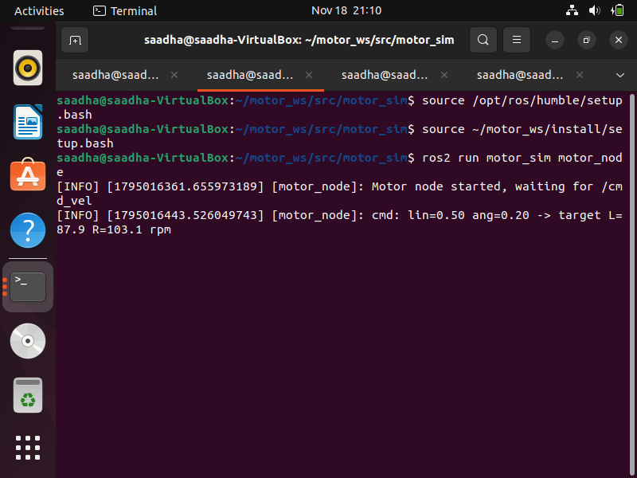

### Test 2: Straight line (target RPM)

- **Terminal 1:** `ros2 run motor_sim motor_node`
- **Terminal 2:** `ros2 topic echo /motor/rpm`
- **Terminal 3:**

```bash
ros2 topic pub --rate 2 /cmd_vel geometry_msgs/msg/Twist "{linear: {x: 0.5}, angular: {z: 0.0}}"
```

Terminal 1 prints:

```
cmd: lin=0.50 ang=0.00 -> target L=95.5 R=95.5 rpm
```

Terminal 2 shows both values rising to about `95.49`. This matches the hand
calculation: `0.5 * 60 / (2 * pi * 0.05) = 95.5`.

> **Screenshot:** Terminal 1 with the `target L=95.5 R=95.5` line.
>
> 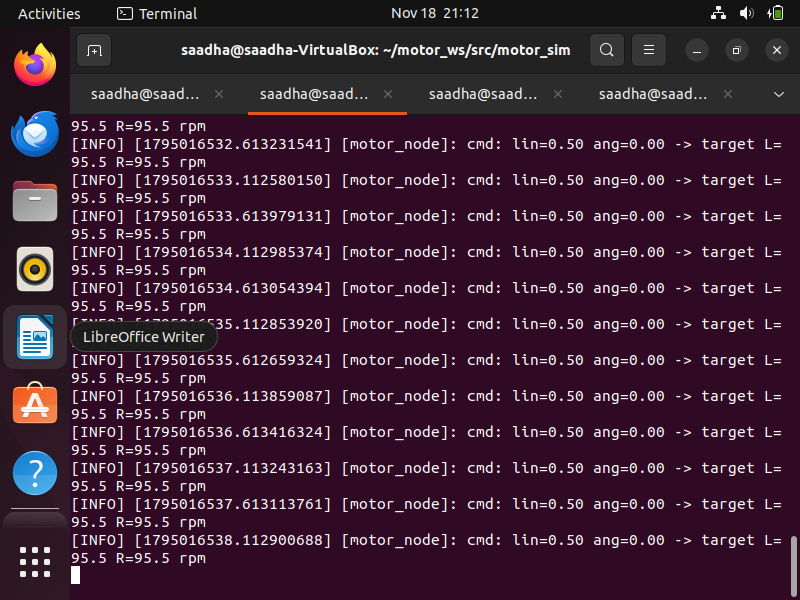

### Test 3: Turning (left and right differ)

Same terminals as Test 2. In **Terminal 3**, stop the previous command with
`Ctrl+C` and send a turning command:

```bash
ros2 topic pub --rate 2 /cmd_vel geometry_msgs/msg/Twist "{linear: {x: 0.5}, angular: {z: 1.0}}"
```

Terminal 1 prints:

```
cmd: lin=0.50 ang=1.00 -> target L=57.3 R=133.7 rpm
```

Check: `half = 1.0 * 0.4 / 2 = 0.2`, so `v_left = 0.3 m/s` (57.3 RPM) and
`v_right = 0.7 m/s` (133.7 RPM). The right motor is faster, as expected for a turn.

> **Screenshot:** Terminal 1 with the `target L=57.3 R=133.7` line.
>
> 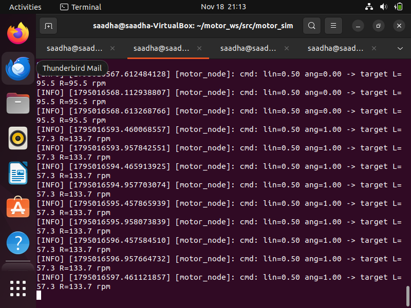

### Test 4: Motor lag (ramp up and ramp down)

The terminal scrolls too fast to read at 50 Hz, so `/motor/rpm` is recorded to a
file instead. With the node running in Terminal 1 and nothing else publishing,
run this block in **Terminal 3**. It sends a straight command for 5 seconds,
then sends a stop command (all zeros) for 1 second:

```bash
source /opt/ros/humble/setup.bash
rm -f ~/rpm_log.txt
timeout 14 ros2 topic echo /motor/rpm --field data --flow-style > ~/rpm_log.txt &
sleep 2
timeout 5 ros2 topic pub --rate 2 /cmd_vel geometry_msgs/msg/Twist "{linear: {x: 0.5}, angular: {z: 0.0}}" > /dev/null
timeout 1 ros2 topic pub --rate 2 /cmd_vel geometry_msgs/msg/Twist "{linear: {x: 0.0}, angular: {z: 0.0}}" > /dev/null
sleep 6
grep -v -- '---' ~/rpm_log.txt | awk 'NR % 25 == 1'
```

Example samples (left motor, same for right), taken about every 0.5 s. Your
numbers will differ slightly:

```
Ramp up:    0 -> 28.9 -> 71.0 -> 86.5 -> 92.2  (approaching 95.5)
Ramp down:  65.4 -> 24.1 -> 8.9 -> 3.3 -> 1.2 -> 0.4 -> ... -> 0.0004
```

The value never jumps. During the ramp down, each half-second shrinks the
remaining RPM by a factor of about 0.37 (e^-1), which is what a first-order lag
with a 0.5 s time constant predicts.

> **Screenshot:** the output of the last command (the ramp up and ramp down).
>
> 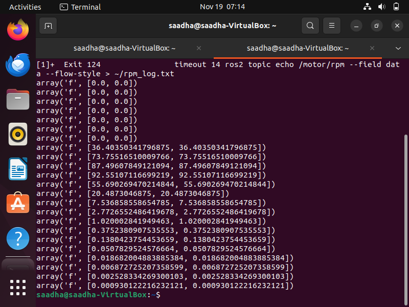

### Test 5: Parameters are configurable

The node's settings (wheel radius, separation, max RPM, time constant, publish
rate) are ROS parameters declared in the node with default values. This test
shows that they are really there, and that changing one changes the behaviour.

**Part A: check the loaded values**

- **Terminal 1:** `ros2 run motor_sim motor_node`
- **Terminal 3:**

```bash
ros2 param list /motor_node
ros2 param get /motor_node wheel_separation
ros2 param get /motor_node max_rpm
```

Expected: the five parameters are listed (plus `use_sim_time`, added by ROS),
then `Double value is: 0.4` and `Double value is: 3000.0`.

> **Screenshot:** the output of these three commands.
>
> 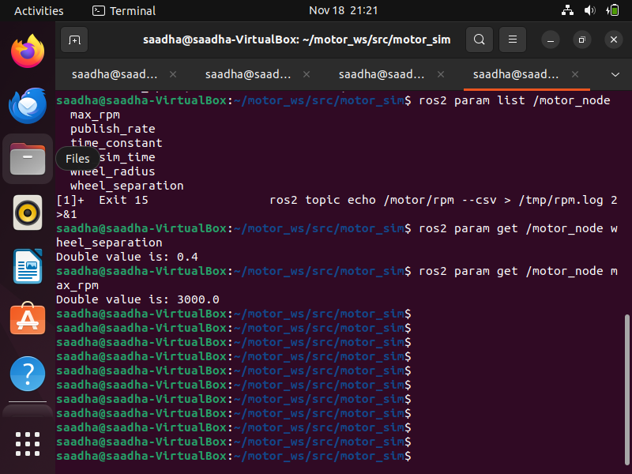

**Part B: change a parameter and see the effect**

A larger wheel radius needs fewer RPM for the same speed, so doubling the radius
should halve the RPM.

1. **Terminal 1:** press `Ctrl+C` to stop the node.
2. **Terminal 1:** start it again with the radius doubled from `0.05` to `0.1`:

```bash
ros2 run motor_sim motor_node --ros-args -p wheel_radius:=0.1
```

3. **Terminal 3:** send the straight command:

```bash
ros2 topic pub --once /cmd_vel geometry_msgs/msg/Twist "{linear: {x: 0.5}, angular: {z: 0.0}}"
```

4. Terminal 1 prints `target L=47.7 R=47.7 rpm`, which is half of the earlier `95.5`.

> **Screenshot:** Terminal 1 showing `target L=47.7 R=47.7 rpm`.
>
> 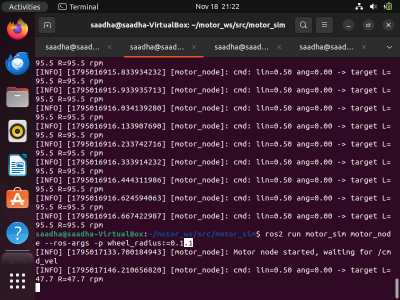

5. **Put it back:** press `Ctrl+C` and start the node again without the
   `--ros-args` part. The override only lasts for that run, so nothing in the
   code or in any file was changed.

---

## Design decisions

- **Python (rclpy):** fast to develop and easy to read for a simulator.
- **Two motors:** the simplest model that shows the full pipeline. The
  conversion is small and isolated, so more thrusters can be added.
- **First-order lag:** a common, simple model of motor speed response. Using
  `1 - exp(-dt / tau)` keeps the behaviour correct at any publish rate.
- **Timer-driven update:** the simulation and telemetry run on a fixed-rate
  timer, independent of how often `/cmd_vel` arrives, as real firmware loops do.
- **`Float32MultiArray`:** a standard message type, so no custom message
  package is needed. The order is fixed: `[left, right]`.
- **Parameters:** physical constants are ROS parameters with defaults, so the
  robot can be reconfigured at start-up without editing code.

---

## Limitations and future work

- Only `linear.x` and `angular.z` are used. A full underwater vehicle would also
  use `linear.y`, `linear.z`, roll, pitch and yaw with more thrusters (for
  example 4 to 6) and a thruster allocation matrix.
- The motor model is a simple first-order lag, with no current, torque, drag
  or voltage limits.
- Telemetry is RPM only. It could be extended with current, temperature and
  fault flags.
- A custom message type with a header and per-motor names would be more
  self-describing than `Float32MultiArray`.
- There is no command timeout. If `/cmd_vel` messages stop arriving, the last
  target is kept, so a stop command (zero velocity) must be sent. A watchdog that
  resets the target to 0 after a short silence would be a sensible safety addition.
- Unit tests for the conversion and lag functions could be added.

---

## License and author

This project is released under the **MIT License**. See the [LICENSE](LICENSE)
file for the full text.

Copyright (c) 2026 Nafeesath Saadha
